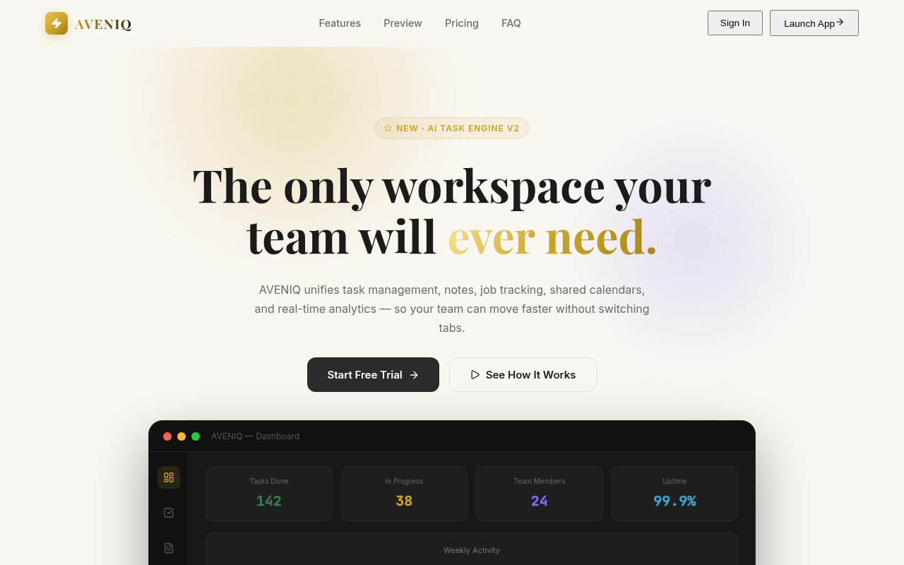

# AVENIQ

A front-end prototype of a team workspace. It puts the things a small team juggles every day — tasks, notes, job openings, a shared calendar and a few key numbers — into one dashboard instead of five browser tabs.

Built with **React 19, Vite, Framer Motion, Recharts and lucide-react**, styled with plain CSS design tokens.

> **Status:** front-end demo. All workspace data is mock data held in React state.
> There is **no backend, no login and no persistence** — refresh clears edits.



## What works now vs. simulated vs. planned

| Area | Status |
| --- | --- |
| Landing page (pitch, features, Kanban preview, pricing, FAQ) | ✅ Works |
| Workspace console navigation (dashboard, tasks, notes, jobs, calendar, team, analytics, settings) | ✅ Works |
| Task board (add / complete / delete, priorities) | ✅ Works in-session |
| Notes (create / edit / delete) | ✅ Works in-session |
| Jobs tracker, calendar, team directory | ✅ UI with sample data |
| Dashboard + analytics charts (Recharts) | 🧪 Sample series |
| Motion (blur-in reveals, hero 3D tilt, scroll progress, page transitions) | ✅ Works; respects reduce-motion |
| Auth / multi-user sync / server persistence | 🗓 Planned |
| Dark mode | 🗓 Planned |

## Setup

```bash
git clone https://github.com/Arham518/flowdesk-saas.git
cd flowdesk-saas
npm install
npm run dev       # Vite dev server
npm run build     # production build → dist/
npm run preview
npm run lint      # oxlint
```

Requires Node 18+.

## Screenshots

| Home |
| --- |
|  |

## Project structure

```
src/
  App.jsx                 landing ↔ workspace switch + scroll progress
  components/             Navbar, Button, Card
  pages/
    SaaSProduct.jsx       marketing landing
    WorkspaceConsole.jsx  dashboard app (all tabs + mock data)
  index.css               design tokens and animation styles
public/                   favicon.svg, icons.svg
```

## Known limitations

- Edits live only in memory; closing the tab loses them.
- Pricing, team members and chart numbers are illustrative.
- No routing library — page state is a React `useState` flag.

## Roadmap

1. Authentication and a real API
2. Persist tasks, notes and jobs
3. Dark mode and shareable workspace links

## Security

This demo needs no secrets. Do not commit `.env` files if you later add API keys.

## Author

Muhammad Arham · [GitHub Arham518](https://github.com/Arham518)
